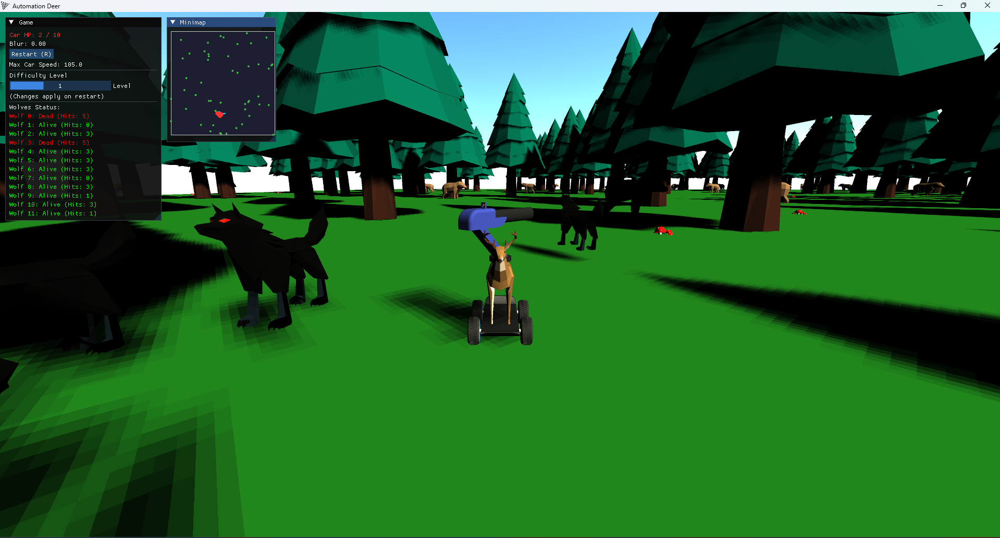
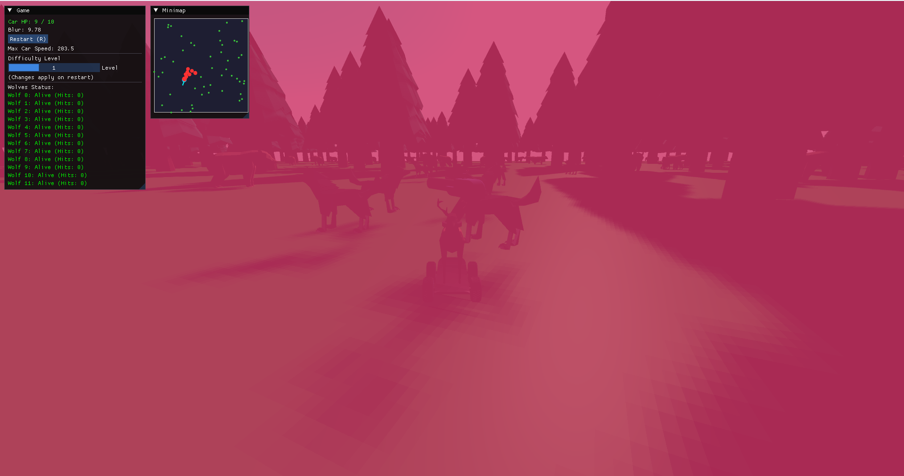
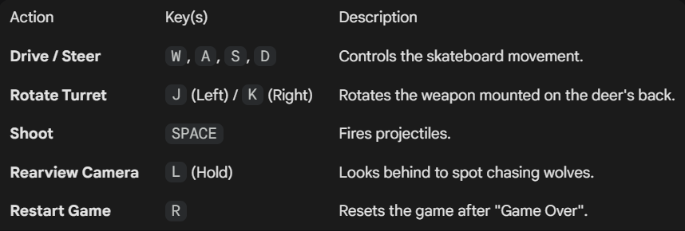

Automation Deer

Candidate Number: 10019

A C++ Arcade Shooter built with Threepp where everything is about winning the fight against the level 3 
WolfPack!

Automation Deer is an action-packed arcade shooter game where you control a turret equipped deer navigating
the mystical forest of trees and mushrooms while battling wolves and bears. The deer has automated a turret 
shooting bullets and electric skateboard to give the wolf pack a fair fight. The objective is to kill all 
the wolves with the turret before the wolves eat the deer making the game a fight for survival.

Game Features:

Physics-based movement:

The deer standing on an electric skateboard moves with acceleration both ways and friction when not accelerating
making it realistic in comparison with a real electrical motor unit. For added game possibilities, the deer can
bounce off all objects except the mushrooms making it possible to change direction quickly. In addition, driving
off the edge of the map will make the deer fall down and die.

Dual-control system:

Drive the deer with WASD keys and independently aim the turret with JK keys this allows
for tank like controls and better gameplay. There is also a dedicated Rearwiew camera activated with the L key.
This makes you never lose sight of the enemies behind you.

Enemy AI:

Wolves spawn in a ring around the player and appear from all angles, forcing the player to react quickly.
As the wolves get hit by bullets, they get faster and more aggressive making the game more challenging.
The wolves use sine/cosine function based movement in addition to randomization to make their movement 
unpredictable and natural. If a wolf touches the deer, you lose one hitpoint if you lose 10 hitpoints you die.

Power-ups/downs:

When collecting a mushroom, the deer both gains speed and loses vision. The mushroom effects decay over time
making it a risk/reward situation. The more you collect, the faster you go but the less you can see.

Bears wander all around the map in randomized directions and funcion as obstacles for the deer, when you hit
a bear you lose topspeed permanently making it harder to escape the wolves.

Intoxicated Deer

World:

Because of the programs widespread use of random generators, each game session is unique with an entirely new map.
The game also features a sky using skybox as well as shadows making the graphics better and decreasing the wolves
visibility. On top the game has built-in overlay for tracking performance, finding the wolves on the minimap and
choosing your difficulty level (1-3).

Game Controls:

Technical Architecture:

Key Classes

* Game: Owns the Scene, Renderer, and the main loop tick, Responsible for initializing all subsystems.

* WorldManager: Manages the lifecycle of dynamic objects like trees, mushrooms, wolves, and bears. 
Also handles spawning and cleanup upon restart.

* CollisionDetection: A collision system using radius checks for efficient hit detection between objects.

* Turret and bullet: Uses KeyListener interface to handle input independently of the car and uses object 
pooling principles for projectiles.

Simplified Class Diagram:

Reflection: 

To start I am very content with the visual representation of the game. I created the Turret skateboard
and wheels in fusion 360 and imported some low poly models creating a nice aesthetic. The game mechanics
also work well and the game feels competitive and fun to play. Coding wise I think the program has good
seperation of concerns, an example is the CollisionDetection system that doesn't know about game logic.

There are also som areas for improvement. For better game continuity I should have made the levels
automatically changing when defeating all wolves, creating a more arcade like experience. The config namespace
in gameConstants.hpp should have been used more consistently throughout the codebase, as there are still some
hardcoded values spread across the program making it hard to configure. You can also argue that Game and WorldManager
start til slightly resemble a God class, as they both have many responsibilities.

Sources:

Deer by Poly by Google [CC-BY] via Poly Pizza

Pine Tree by Danni Bittman [CC-BY] via Poly Pizza

Mushrooms by Jarlan Perez [CC-BY] via Poly Pizza

Bear by Poly by Google [CC-BY] via Poly Pizza

Wolf by Lee Mason [CC-BY] via Poly Pizza

Youbot Keycontroller,
https://github.com/markaren/threepp/blob/master/examples/projects/Youbot/KeyController.hpp

Deepwiki for threepp imgui and catch2 https://deepwiki.com/markaren/threepp